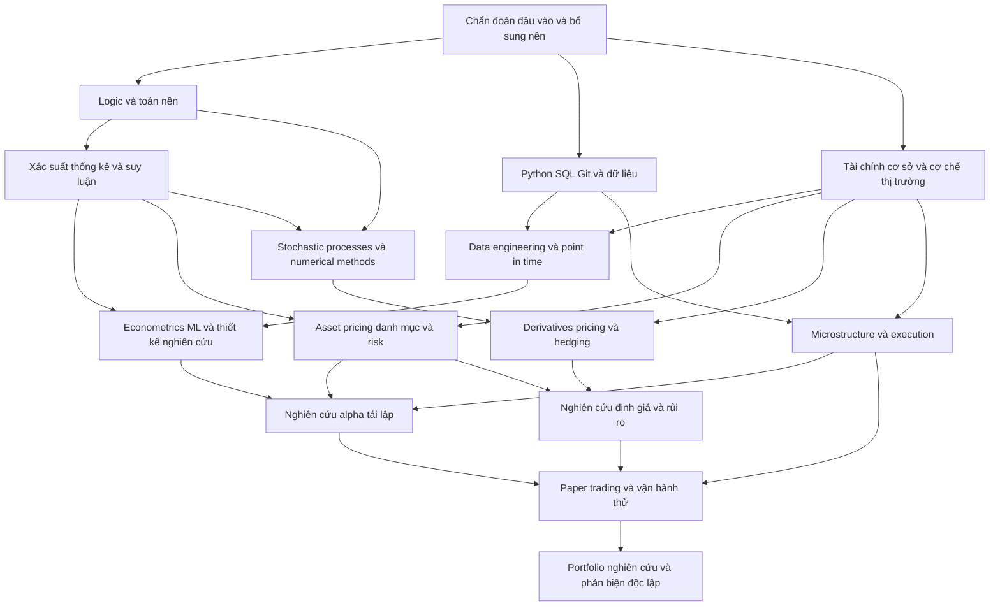

# Bản đồ năng lực quant researcher — khảo sát nền tảng

Ngày kiểm tra: 23/11/2026. Trạng thái: **đề xuất để người học duyệt**, chưa phải lộ trình đã chốt. Khảo sát dùng 5 truy vấn Exa, mỗi truy vấn 5 kết quả (25 lượt kết quả, có trùng), sau đó đọc trực tiếp 5 trang chính. Không phải khảo sát đầy đủ mọi vị trí quant hay chứng nhận độ sẵn sàng nghề nghiệp.

Đầu vào người học vừa xác nhận: ưu tiên **quant trader/developer — xây hệ thống và giao dịch**, phương pháp nghiên cứu hỗ trợ; tài chính từ đầu, toán/Python có nền tảng cơ bản nhưng không bỏ giải thích chi tiết. Chưa có thời lượng hay hạn hoàn thành. Các mục tiêu chuyên sâu bên dưới là hướng phát triển tùy chọn, không phải tất cả điều kiện đầu vào.

## Những gì nguồn trực tiếp cho thấy

| Nguồn | Quan sát có bằng chứng | Hàm ý thiết kế, là suy luận |
|---|---|---|
| [Jane Street — QR internship](https://www.janestreet.com/join-jane-street/position/8498547002/) | Công việc bao gồm thiết kế thí nghiệm, tạo dữ liệu, chuỗi thời gian, feature engineering, xây mô hình và đưa tín hiệu vào sản xuất; yêu cầu Python, tư duy toán và truyền đạt chính xác. Công ty nói ranh giới nghiên cứu–công nghệ–trading có giao thoa. | Không thể thay nghiên cứu bằng bài tính toán; phải có dự án đi hết vòng đời tín hiệu. |
| [Citadel Securities — researcher/analyst](https://www.citadelsecurities.com/careers/details/quantitative-researcher-quantitative-research-analyst/) | Mô hình thị trường, phân tích thống kê, dữ liệu lớn/không truyền thống, chuyển thuật toán thành code, backtest và triển khai. Xác suất, thống kê, ML, time series và giao tiếp nằm trong yêu cầu. | Tách năng lực phát biểu giả thuyết, xử lý dữ liệu, kiểm định và triển khai; không dùng điểm trắc nghiệm làm đại diện tất cả. |
| [Two Sigma — campus QR](https://careers.twosigma.com/careers/JobDetail/New-York-New-York-United-States-Quantitative-Researcher-Full-Time-Campus-Hire/13946) | Phương pháp khoa học, tạo và thử ý tưởng đầu tư, phối hợp kỹ sư, đọc nghiên cứu; yêu cầu dự án nghiên cứu sâu trên dữ liệu thực và giao tiếp rõ ràng. Trang này nhận bằng từ bachelor đến doctorate. | Phải dạy đọc paper, tái lập, phản biện và viết báo cáo. Không suy ra mọi việc QR đều bắt buộc PhD. |
| [Berkeley MFE curriculum](https://mfe.haas.berkeley.edu/academics/curriculum) | Kết hợp toán, thống kê, lập trình với bối cảnh thể chế; học định giá, đầu tư, thực nghiệm, stochastic calculus, derivatives, fixed income, data science và risk. Có applied project và internship/independent study. | Toán không được học tách biệt hoàn toàn với diễn giải hợp đồng, thị trường và rủi ro. Đây là một chương trình tham chiếu, không phải chuẩn chung cho mọi QR. |
| [Wintermute — MFT researcher](https://www.wintermute.com/company/opportunities/0874ca9b-7c02-4364-bb78-b7b04272351e) | Vị trí có kinh nghiệm: dữ liệu độ phân giải cao, mô hình dự báo, microstructure, backtest/simulation, Python, cộng tác execution; API sàn và dữ liệu blockchain là điểm cộng. | Crypto cần nội dung riêng về venue/data/execution; không chỉ đổi ticker trong ví dụ cổ phiếu. Yêu cầu thành tích production của vị trí giàu kinh nghiệm không phải mục tiêu nhập môn. |
| [BIS — FX execution 2025](https://www.bis.org/publications/qr-202512/fx-trade-execution-landscape-through-prism-2025-bis-triennial-survey) | FX là thị trường OTC phân mảnh; nhiều cách thực thi và đối tác thanh khoản; forwards/swaps thêm rủi ro đối tác tương lai. Đã đọc phần trích xuất tìm kiếm, chưa đọc toàn bộ bài. | Phải phân biệt FX spot, forwards, swaps, futures và sản phẩm retail; dữ liệu một broker không đại diện toàn thị trường. |
| [BIS — FX execution algorithms](https://www.bis.org/publications/fx-execution-algorithms-and-market-functioning.pdf) | Thuật toán execution thực thi lượng giao dịch đã xác định; khác với thuật toán tìm cơ hội/market making. Có đánh đổi market impact, rủi ro thị trường và độ chắc chắn hoàn tất. Đã đọc trích xuất, chưa kiểm toàn văn. | Phải dạy riêng bài toán alpha và execution; lợi nhuận dự báo không tự chuyển thành khả năng giao dịch. |

Chất lượng: các trang tuyển dụng là nguồn trực tiếp của nhà tuyển dụng nhưng có mục đích tuyển dụng, không phải nghiên cứu hiệu quả giáo dục. Chương trình đại học mô tả điều được dạy, không chứng minh rằng tự học theo danh sách sẽ đạt cùng kết quả. BIS là nguồn nghiên cứu thị trường trực tiếp; chưa kiểm toàn văn hai bài nên không dùng để suy ra chi tiết ngoài trích xuất. Không sử dụng trang tổng hợp việc làm trong kết luận. Ngày tuyển dụng và tính còn mở của từng vị trí không được bảo đảm.

## Bốn hướng nghề nghiệp phải phân biệt

1. **Alpha / systematic research:** dự báo có điều kiện, giả thuyết kinh tế, dữ liệu, ước lượng, chọn mô hình, kiểm định ngoài mẫu, xây danh mục và đánh giá sau chi phí.
2. **Pricing / derivatives / risk research:** no-arbitrage, replication, stochastic processes, numerical pricing, calibration, Greeks, hedging, model risk và sản phẩm phái sinh. Không đồng nghĩa tìm tín hiệu giá.
3. **Quant developer / research engineer:** pipeline, API, cơ sở dữ liệu, reproducibility, testing, hiệu năng, mô phỏng và triển khai. Mức C++/distributed systems phụ thuộc chuyên môn; không áp HFT làm đầu vào bắt buộc mọi người.
4. **Quant trader / execution / market making:** order book, thanh khoản, inventory, fills, costs, hedging, kiểm soát rủi ro và vận hành theo thời gian thực. Giao thoa với QR nhưng cần tiêu chí đánh giá khác.

Đề xuất theo lựa chọn mới: phần chung đủ rộng, **nhánh quant trader/developer là xương sống**; thống kê, phương pháp nghiên cứu, pricing và risk phục vụ việc hiểu, thiết kế và kiểm tra hệ thống. Không bỏ toán/chứng minh chỉ vì ưu tiên xây hệ thống. “Biết tất cả mọi thứ” không phải tiêu chí có thể kiểm chứng; cần danh mục năng lực với trạng thái đã học, đã thực hành, đã có bằng chứng và còn thiếu.

Thứ tự định hướng, chưa chốt chương trình: (1) tài chính và hợp đồng từ gốc song hành với ôn toán/Python có giải thích, (2) dữ liệu và sổ giao dịch/định giá/P&L có kiểm toán, (3) xác suất–thống kê–time series cùng simulator, (4) chiến lược baseline và kiểm định nghiêm ngặt, (5) portfolio/risk/execution, (6) hệ thống paper trading có khả năng phục hồi và quan sát, (7) chọn chuyên sâu và nghiên cứu độc lập. Mỗi giai đoạn cần bài giảng nền tảng, dẫn xuất, ví dụ, phản ví dụ, bài tập và kiểm tra hiểu trước khi mở rộng code. Chưa đặt số tuần hoặc số buổi.

## Các miền năng lực đề xuất

| Miền | Nội dung cần bao phủ | Bằng chứng thực hành nên có |
|---|---|---|
| Ngôn ngữ và lập luận | Logic, lượng từ, định nghĩa, giả thiết, phản ví dụ, chứng minh; đọc tiếng Anh kỹ thuật | Giải thích một khái niệm bằng lời, ví dụ và phản ví dụ; chứng minh có nêu giả thiết |
| Toán nền | Đại số tuyến tính, giải tích một/nhiều biến, tối ưu, numerical methods | Dẫn xuất công thức, kiểm tra đơn vị/biên, đối chiếu giải tay và code |
| Xác suất và thống kê | Conditional probability/expectation, estimation, uncertainty, dependence, hypothesis tests, multiple testing | Thiết kế thí nghiệm mô phỏng; giải thích khi kết luận thất bại |
| Tài chính nền | Cash flows, giá trị thời gian, hợp đồng, returns/P&L, leverage, margin, accounting, corporate finance, asset pricing | Sổ cash-flow/P&L, valuation đơn giản, giải thích economic mechanism |
| Kinh tế và thị trường | Macro, monetary policy, institutions, liquidity, market structure, ethics và market conduct | So sánh cơ chế thị trường; phân biệt giả thuyết kinh tế với tương quan |
| Dữ liệu | Timestamp/event time, publication lag, revisions, corporate actions, delistings, identifiers, missingness, lineage | Dataset manifest + kiểm tra point-in-time + báo cáo lỗi dữ liệu |
| ML và econometrics | Regression, regularization, time series, volatility, stationarity, cointegration, cross-sectional models, model selection | Baseline trước mô hình phức tạp; chronological evaluation; sensitivity/ablation |
| Research process | Literature review, hypotheses, trials log, frozen evaluation, negative controls, uncertainty, replication | Paper reproduction và báo cáo có kết quả âm, limitations, môi trường tái lập |
| Portfolio và risk | Allocation, covariance, constraints, factor exposure, turnover, drawdown, tail/liquidity/counterparty/model risk | Danh mục có ràng buộc, stress scenarios, phân rã kết quả |
| Execution và simulation | Order types, spread, fees, queue/fill uncertainty, impact, borrow/funding, event-driven simulation | Mô phỏng với ledger kiểm toán được; so sánh giả định fills |
| Software và vận hành | Python, SQL, Git, tests, packaging, CI, logging, monitoring, secrets, reconciliation, kill controls | Pipeline chạy lại được, paper-trading harness, thử mất kết nối/duplicate event |

Danh sách trên là tổng hợp thiết kế, không tuyên bố từng nhà tuyển dụng đòi tất cả mục. Learning artifacts không tự chứng minh profitability hoặc khả năng vận hành tiền thật.

## Phần riêng theo thị trường

- **Stock:** quyền sở hữu/cash flows, báo cáo tài chính, corporate actions, universe tại thời điểm, survivorship/delisting, factors, borrowing/shorting, lịch giao dịch và auction. Cần bổ sung nguồn exchange/regulator chính thức trước khi viết bài chi tiết cho từng quốc gia.
- **Crypto:** spot–perpetual–futures–options, funding/margin/liquidation, sàn và custody/counterparty, fragmentation, blockchain/on-chain timestamps, stablecoins, cơ chế AMM/DEX và phí. Các đặc điểm AMM, liquidation và custody ở đây là đề xuất cần nguồn chính thức riêng, không suy ra chỉ từ tin tuyển dụng.
- **FX:** currency pairs/numeraire, rates/carry, spot–forward–swap, quotation conventions, OTC liquidity, broker-specific data, settlement/counterparty risk. Không đánh đồng retail forex/CFD với toàn bộ thị trường FX thể chế.

## DAG tiên quyết sơ bộ — chưa ấn định tuần học

Các nhánh stock/crypto/FX gắn vào D, F, H, J và K, không chỉ đặt ở cuối khóa. Một lesson có thể gắn nhiều competency IDs, nhưng cần chính xác điều được dạy sâu và điều chỉ được nhắc đến. Không khóa các buổi vào lịch hai năm trước khi biết nền tảng và thời lượng người học.

## Quyết định cần người học chốt

- Đã chốt trục nghề nghiệp quant trader/developer; còn cần thị trường ưu tiên và mức sâu derivatives/HFT/DeFi.
- Đã biết tài chính từ đầu, toán/Python cơ bản; cần chẩn đoán cụ thể và thời gian học thực tế, không tự giả định học nhanh.
- Sẵn sàng học tiếng Anh và mức song ngữ mong muốn.
- Chỉ tài nguyên miễn phí hay có ngân sách sách/data; không tự mua hoặc đăng ký.
- Đánh giá ngoài do chuyên gia/nhóm học hỗ trợ hay chỉ tự đánh giá. Không tự gắn nhãn mastery với điểm trắc nghiệm.

## Giới hạn khảo sát và việc cần bổ sung

Chưa đủ nguồn để khóa curriculum hoàn chỉnh. Chưa có khảo sát công việc theo thị trường Việt Nam, yêu cầu pháp lý địa phương, phỏng vấn người hành nghề, hay danh mục sách/data đã xác minh quyền truy cập. Chưa xác minh full text BIS và chưa kiểm đối chiếu từng miền với ít nhất hai nguồn. Hướng dẫn này phục vụ thiết kế học, không phải hướng dẫn giao dịch hay hứa hẹn công việc/lợi nhuận.

sources_reviewed: 25
